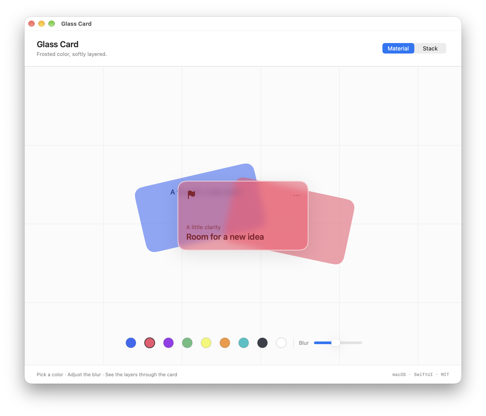
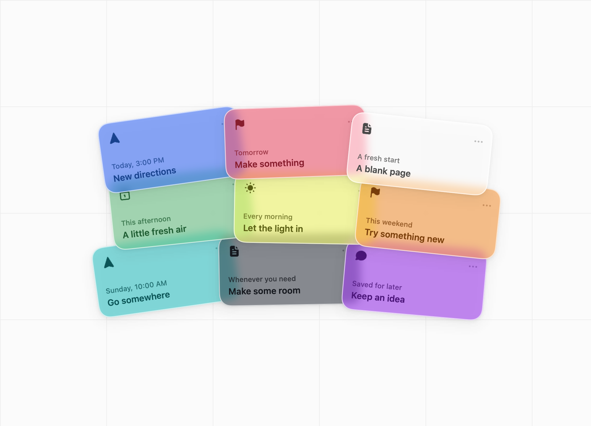
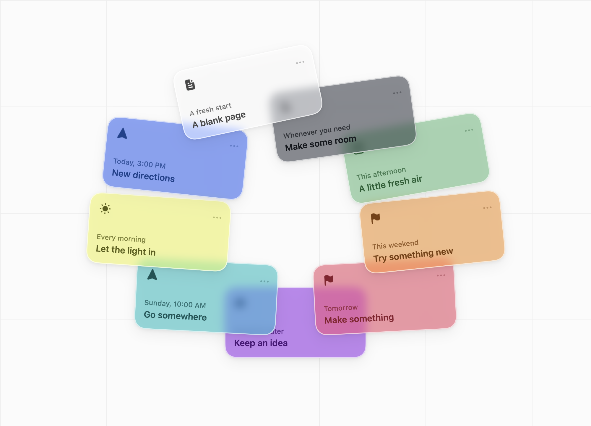

# Glass Card

Frosted color, softly layered.

A small macOS SwiftUI package for colored glass cards. Supply a backdrop and your own content; the material blurs the layers underneath, adds a translucent tint, and finishes the card with a soft white rim.

[简体中文](README.zh-CN.md)



## What it includes

- A reusable card surface with custom SwiftUI content.
- Nine color presets, plus custom tint, foreground color, and opacity.
- Adjustable blur and corner radius.
- A macOS demo with a material study and two overlapping layouts: **Layered** and **Ring**.

The public library exposes the material. Layout, expansion, selection, dragging, and the filled icons are examples in the demo target.

**The blur uses an explicitly supplied backdrop.** It redraws that view; it does not automatically capture live views behind the card. See [How the material works](#how-the-material-works).

## Requirements

macOS 14 or later, Swift 5.9 or later, and Xcode command-line tools. The package has no external dependencies.

## Try the demo

Download the macOS demo or source archive from the [v0.1.0 release](https://github.com/alexko0421/glass-card/releases/tag/v0.1.0). To build the demo from source, run this from the package directory:

```sh
swift run GlassCardDemo
```

In **Material**, select a color and adjust the blur. In **Stack**, choose **Layered** or **Ring**, then click **Expand**. Click a card to select it; click empty space or press Esc to collapse the stack. Drag down to expand, or up to collapse. Hover expansion is optional.

| Layered | Ring |
| --- | --- |
|  |  |

## Use a card

In Xcode, add `https://github.com/alexko0421/glass-card` as a package dependency, starting from version **0.1.0**, and select the **GlassCard** library product. You can also add a downloaded source directory as a local package.

```swift
import SwiftUI
import GlassCard

struct Example: View {
    var body: some View {
        GlassCard(swatch: .rose) {
            VStack(alignment: .leading, spacing: 6) {
                Text("A little clarity").font(.caption)
                Spacer()
                Text("Room for a new idea").font(.headline)
            }
        }
        .frame(width: 300, height: 160)
        .shadow(color: .black.opacity(0.08), radius: 16, y: 7)
    }
}
```

The convenience initializer uses the bundled grid paper as its backdrop. For color mixing, supply the scene you want to show through the card:

```swift
GlassCard(
    swatch: .rose,
    cornerRadius: 20,
    blurRadius: 7,
    backdrop: {
        HStack(spacing: 0) {
            Color.blue
            Color.pink
        }
    }
) {
    Text("Your own content").font(.headline)
}
.frame(width: 300, height: 160)
```

`GlassCard` accepts arbitrary SwiftUI content, including controls. It provides 16-point padding, the rounded clipping shape, tint, and rim. Add shadows and interactions with normal SwiftUI modifiers.

## How the material works

The surface composites the supplied backdrop, increases its saturation, applies blur, adds the tint, and clips the result to a mask. Foreground content remains sharp.

For overlapping scenes, use `GlassCardMaterial` directly. Keep the backdrop and mask in the same coordinate space:

```swift
ZStack {
    underlyingScene

    GlassCardMaterial(
        swatch: .rose,
        blurRadius: 7,
        backdrop: { underlyingScene },
        mask: {
            RoundedRectangle(cornerRadius: 20)
                .frame(width: 300, height: 160)
        }
    )

    // Add foreground content and the card rim here.
}
```

`underlyingScene` represents your own repeatable view of the layers below the card. Backdrop views should be noninteractive and free of side effects, because they are drawn again. A parent `.background` modifier alone does not supply a blur source.

The demo redraws lower cards as flattened layers. Overlapping cards therefore approximate several layers of glass rather than recursively compositing the full material of every lower card. Large stacks have not been benchmarked.

## Public API

| Type | Purpose |
| --- | --- |
| `GlassCard` | Rounded material, foreground content, padding, and white rim. |
| `GlassCardMaterial` | Decorative material with a caller-supplied backdrop and mask. |
| `GlassSwatch` | Tint, foreground color, and opacity. |
| `GlassPaper` | The demo's grid-paper backdrop. |

The presets are `.blue`, `.rose`, `.violet`, `.mint`, `.lemon`, `.orange`, `.teal`, `.graphite`, and `.pearl`. Most use 58% tint; pearl uses 45%. You can also create a custom swatch:

```swift
GlassSwatch(tint: .purple, ink: .white, opacity: 0.4)
```

Foreground contrast depends on the backdrop. The material itself is still; the demo respects Reduce Motion for expansion animations.

## Development

```sh
swift build
swift test
swift run GlassCardDemo --render-previews ./previews
```

Four tests cover the rounded mask, blur boundary, tint behavior, and opacity handling. Three inspect rendered SwiftUI pixels; the fourth checks swatch opacity values. The preview command exports six PNGs: material, layered, ring, collapsed, single, and empty.

See [CONTRIBUTING.md](CONTRIBUTING.md) for the code structure and [CHANGELOG.md](CHANGELOG.md) for changes.

## Credits and license

The visual inspiration is sam ([@artntek](https://x.com/artntek)) and [Event Stack Shifting](https://x.com/artntek/status/2100247096993485129). Glass Card is an independent SwiftUI implementation inspired by that work. No original video or artwork is bundled.

The implementation is [MIT licensed](LICENSE), copyright 2026 Chunlong Ko. The demo includes six [Tabler Icons](https://tabler.io/icons) filled SVGs, version 3.46.0; their MIT license is preserved in [THIRD_PARTY_NOTICES.txt](THIRD_PARTY_NOTICES.txt).
